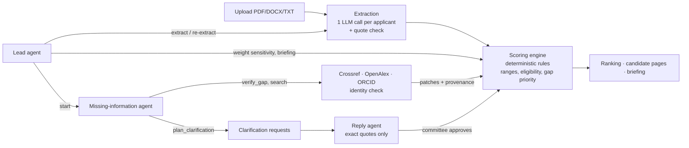

# Evidence-aware CV screening: an agentic AI system

[](../../actions/workflows/ci.yml)

Most screening tools treat missing information as a "no": a CV that never states the PhD loses the points, even when
the applicant's postdoc and lecturer posts make it obvious. This project screens academic job applications with
**incomplete information handled explicitly**, and uses **AI agents** to close the gaps that actually matter.

* Every requirement is *met*, *not met* or *not established*; an omitted qualification is never treated as absent.
* Every score is a **range** (supported → possible). Applicants whose range crosses the shortlist cut-off are flagged
  *uncertain* instead of being ranked with false confidence.
* **Three AI agents** (tool calling, any LLM provider) extract the applications, check publications against
  Crossref, OpenAlex and ORCID, draft clarification questions, read applicants' replies and brief the committee.
* **Guardrails live in code, not prompts**: scoring is deterministic, sources must be approved, records must pass an
  identity check, and nothing an agent proposes from a reply is applied without committee approval. (Recruitment AI is
  *high-risk* under the EU AI Act; this design keeps decisions explainable and with people.)

<!-- Add a screenshot or GIF of the Ranking page here:  -->

## Results

`python scripts/evaluate.py` compares the system with two common baselines on 14 fictional applications whose
hidden "truth" (the facts the documents left out) is known. Shortlist size 5.

| Method | Shortlist precision | Kendall τ vs true order | Truly eligible applicants wrongly excluded |
|---|---|---|---|
| Keyword similarity (ATS-style TF-IDF) | 0.8 | 0.39 | n/a (no eligibility check) |
| Missing = absent (points, unstated → 0) | 0.6 | 0.67 | 4 |
| **Evidence-aware (documents only)** | **0.8** | **0.80** | **0** |
| **Evidence-aware + clarifications to the 5 flagged applicants** | **1.0** | **0.96** | **0** |

Also measured: 8 of 14 decisions made confidently with no errors among them; all 42 requirement states (14 applicants × 3 required
items) match the gold labels; the true score falls inside the score range for 12 of 14 applicants (the two misses are reported
by the script). *Caveat: a small synthetic set written to cover typical gap scenarios, scored on the gold extraction.
It shows the method's behaviour, not field accuracy on real CVs.* With `position_id`, `POST /api/evaluate` also
scores a real model's extraction of the demo applications against the gold extraction.

## Architecture



* **Agents** (`backend/agent.py`, `lead_agent.py`, `reply_agent.py`) share one protocol-neutral tool loop.
* **Provider layer** (`backend/llm.py`): Claude (official SDK), Gemini, and any OpenAI-compatible API (OpenAI, Groq,
  OpenRouter, Mistral, DeepSeek, Ollama, …), switchable at runtime; retries with back-off, provider rate-limit hints,
  token accounting, resumable runs.
* **Background jobs** (`backend/jobs.py`): agent runs execute off the request thread; the interface streams the log live
  and shows model calls, tokens and rate-limit waits.

## Run it

Requires Python 3.10+.

```bash
pip install -r requirements.txt
uvicorn backend.app:app --port 8000
```

Or with Docker:

```bash
docker build -t cvscreen .
docker run -p 8000:8000 -v cvscreen-data:/data cvscreen
```

Open http://localhost:8000. On first start it creates an example position (Assistant Professor in Computer Science)
with 14 demo applications already extracted, so everything works without an API key (the agents then run scripted
fallbacks).

For your own CVs, pick an AI provider under *1 · Position & parameters → AI model*:

| Protocol | Covers | Set |
|---|---|---|
| Claude (Anthropic API) | Claude models | key (or `ANTHROPIC_API_KEY`), model |
| Google Gemini | Gemini models | key (or `GEMINI_API_KEY`), model |
| OpenAI-compatible | OpenAI, Ollama, OpenRouter, Groq, Mistral, DeepSeek, Together, LM Studio, vLLM, any `/v1/chat/completions` server | base URL, model, key (optional for local servers) |

Keys stay in server memory (or come from environment variables) and are never saved or sent to the browser. The
agents need a model that supports tool (function) calling. To add another API protocol, add one JSON-completion
function (`JSON_CALLS`) and one `ToolChat` subclass (`CHAT_KINDS`) in `backend/llm.py`.

### Tests

```bash
pip install -r requirements-dev.txt
pytest                         # 32 tests: scoring, agents vs a fake model server, guardrails, retries, jobs, auth, privacy
python scripts/smoke_test.py   # end to end without a browser
python scripts/evaluate.py     # the results table above
```

GitHub Actions runs all three and builds the Docker image on every push.

### Deployment settings

| Variable | Effect |
|---|---|
| `CVSCREEN_PASSWORD` | Password for the whole app (browser login prompt; any user name) |
| `CVSCREEN_PUBLIC_DEMO=1` | Showcase mode: no model calls, uploads, settings changes, deletions or live lookups; scripted agents on recorded data |
| `CVSCREEN_RETENTION_DAYS` | Delete applications inactive for this many days at startup |
| `CVSCREEN_DB` | SQLite file location (the Docker image uses `/data`; serverless uses `/tmp`) |
| `CVSCREEN_JOB_WORKERS` | Parallel background jobs (default 2) |
| `ANTHROPIC_API_KEY`, `GEMINI_API_KEY`, `OPENAI_API_KEY` (+ `OPENAI_MODEL`, `OPENAI_BASE_URL`) | Provider keys |

**Hosting the public demo**
* **Vercel**: import the GitHub repository at vercel.com → Add New → Project → Deploy (no settings needed;
  `vercel.json` and `api/index.py` are included). On Vercel the app switches to public demo mode automatically:
  serverless functions cannot keep background jobs running or share a database, so runs finish inside the request and
  every instance seeds the same example position. Visitors' changes (replies, weight edits) are temporary.
* **Render**: `render.yaml` deploys the same demo (New → Blueprint).
* For real use with your own model and files, run it on a server or container platform (Docker image above) with
  `CVSCREEN_PASSWORD` set, not on serverless hosting.

 Applicant data can be exported
(`GET /api/candidates/{id}/export`) and deleted (`DELETE /api/candidates/{id}`).

## The pipeline

| Step | Where | What happens |
|---|---|---|
| 1. Upload | *Applications* | Drop many files or folders (PDF, DOCX, TXT). Files are grouped per applicant by folder or file name; document type (CV, cover letter, publication list, statements) is detected from the name. Up to 100 applications. |
| 2. Extract and display | *Applications → Extract*, then click a candidate | The AI model reads **all** of an applicant's documents together and returns structured facts (degrees, positions, teaching, leadership, publications, grants, supervision). Every fact carries a quote. Each quote is then checked against the document text: *found*, *close match* or *not found*. Facts whose quote is not found do not count toward the supported score. |
| 3. Requirements and criteria | *Position & parameters* | Required / preferred / good-to-have / committee-judged requirements, criterion weights and scoring rules. |
| 4. Score and rank | *Ranking*, candidate page | Per-criterion breakdown with the item, points and quote behind each number; supported and possible score; eligibility; shortlist status. |
| 5. Adjust and recalculate | *Ranking* (weights) or *Position & parameters* (all rules) | The ranking recalculates immediately. Set a **baseline** first to see each candidate's movement and the reason. |
| 6. Missing information | *Missing information*, candidate page | The resolution process below; clarification requests; recording an applicant's reply updates the ranking. |

## Parameters and their effect on the score

```
criterion score (0–10) = min(points, cap) / cap × 10
overall score (0–100)  = Σ (weight / total weight) × criterion score × 10
```

| Parameter | Default | Effect |
|---|---|---|
| Weights: qualifications / publications / teaching / academic & research experience / leadership / funding / supervision | 10 / 30 / 20 / 15 / 10 / 10 / 5 | Relative importance. Raising a weight helps candidates who are above average on that criterion. |
| Publication points | journal 2, conference 1.5, book 3, chapter 1, preprint 0.25; cap 12 | Only publications in the recency window count. |
| Recency window | 6 years | Shortening it removes older papers from the score. |
| Teaching points per year | lead 2.5, assistant 1; cap 10 | Four years as lead instructor gives full marks. |
| Academic/research experience | 2 per year; cap 10 | Postdoc, lecturer, research scientist posts. |
| Leadership | 2 per year; cap 10 | Directing, chairing, heading, coordinating. |
| Funding | PI 4, Co-I 2; cap 10 | An unstated role gives a range between the two. |
| Qualifications | PhD 10, in progress 4, Master's 3; unrelated field × 0.5 | Highest degree counts. |
| Undated role | supported 0 years, possible up to 4 years | Width of the range for roles without dates. Widening it makes more candidates "uncertain". |
| Unknown supervision count | 1 to 3 students | Same idea for "supervised several students". |
| Shortlist size k | 5 | Top k eligible candidates by supported score. |

### Requirement states and eligibility
* **Met**: positive evidence in a document, a verified source or a recorded reply.
* **Not met**: positive evidence that it is *not* met (e.g. "PhD expected 2028" when the deadline is 2027, or fully dated teaching that totals less than the minimum).
* **Not established**: not stated, partly stated, or conflicting. **An omitted qualification is never treated as absent.**
* A required item *not met* → **ineligible**. A required item *not established* → **eligibility open**.

### Shortlist status
* **Robust in**: in the top k under every resolution of the open information.
* **Robust out**: cannot reach the top k even at its possible score.
* **Uncertain**: its range, or its eligibility, crosses the cut-off. The system flags it for verification instead of ordering it confidently.

### Gap priority (what to clarify first)
1. Eligibility of a shortlist contender.
2. A gap that alone could move the candidate into the shortlist.
3. Gaps that could change the shortlist together.
4. Not pursued: cannot change the outcome. Nobody is asked about these.

## The agents
The system has three AI agents. All three share one tool-calling core (`backend/agent.py`), work with any configured
provider, and follow the same principle: **the AI gathers evidence and proposes; code enforces the rules; the scoring
rules and the committee decide.**

| Agent | Where | What the AI decides | What it can never do (enforced in code) |
|---|---|---|---|
| **Lead agent** ([lead_agent.py](backend/lead_agent.py)) | *5 · AI screening → Screen applications* | Order of work; which applications to extract; whether a weak extraction is worth re-running; when to run the missing-information agent; whether to test the shortlist against weight changes; what to tell the committee | Change scores, weights, requirements or shortlist size; keep a re-extraction that is worse than the previous one; invent figures (the briefing table comes from the scoring engine) |
| **Missing-information agent** ([agent.py](backend/agent.py)) | *4 · Missing information*, or started by the lead agent | Which gaps to pursue, which approved source to query, whether to retry with its own search, what to ask each applicant | Use unapproved sources; use records that fail the identity check; overwrite documented values; ask about gaps that cannot change the outcome |
| **Reply agent** ([reply_agent.py](backend/reply_agent.py)) | Candidate page → *Read the applicant's reply with AI* | How the reply maps to the open items, and the values it states | Change anything without committee approval; propose a value without an exact quote from the reply; use implausible values or resolve a conflict to a value not on record |

Extraction itself is a single AI call per application (step 2); the lead agent decides when to re-run it.

### Missing-information agent in detail
*Missing information → Run the process* starts an **AI agent** (whichever provider is selected) in a tool-use loop
([backend/agent.py](backend/agent.py)). The agent decides what to do next. The pipeline does not script it:

* which applicants and gaps to work on (the scoring engine's gap priorities are its guide);
* which approved source to query for each gap (Crossref, OpenAlex, ORCID works/education/employment);
* whether to retry a failed lookup with its own search query, and whether to accept a record it found;
* what (if anything) to ask each applicant. It sees each change's effect on the shortlist before choosing the next step.

Its tools: `get_shortlist_state`, `get_candidate_gaps`, `verify_gap`, `search_publication`, `accept_publication_record`,
`spot_check_orcid`, `plan_clarification`, `finish`. Every tool call is shown in the run log; source records go to the provenance table.

**Enforced in code, whatever the agent asks for:** scores come only from the scoring rules (re-run after every change);
only approved sources are used, and none if external checks are off; records that fail the identity check
(ORCID iD, or full name plus shared affiliation) are logged and never used; documented values are never overwritten
(disagreements become conflicts); applicants are never asked about gaps that cannot change the outcome; tool calls are capped (120).
Anything unresolved stays *not established*.

Without an API key (offline mode) a **scripted** policy drives the same tools in a fixed order (check every priority 1–3 gap once,
in ranking order, then apply the default clarification rule). This keeps the demo and `scripts/smoke_test.py` working offline. It is a workflow, not an agent.

Source access has two modes: *Recorded responses* (bundled, used for the demo applications) and *Live* (real internet access from your machine).

## Demo applications (all fictional)

| ID | Applicant | Scenario |
|---|---|---|
| A01 | Layla Haddad | Complete, strong (control) |
| A02 | Omar Farouk | PhD never stated, but postdoc and lecturer roles imply one |
| A03 | Sara Mansour | Leadership role with no dates, near the cut-off |
| A04 | Youssef Adel | Four publications missing year/venue; one external record belongs to a different person |
| A05 | Nadia Karim | CV and cover letter disagree on PhD year, teaching start and leadership length |
| A06 | Karim Saleh | Evidence a requirement is **not met**: PhD expected after the start date |
| A07 | Hana Ibrahim | Complete, mid-ranked (control) |
| A08 | Tarek Nabil | Undated teaching, but even the best case is far below the cut-off |
| A09 | Mona Fathy | Required teaching never mentioned |
| A10 | Amr Hassan | Many gaps, none worth chasing |
| A11 | Dina Samy | Grant role and supervision count not stated |
| A12 | Rami Aziz | ORCID record disagrees with the CV on a publication year |
| A13 | Salma Youssef | Complete, strong (control) |
| A14 | Hossam Ali | PhD field differs between documents (both acceptable) |

Each folder in `data/synthetic/` holds the documents, the gold extraction (`gold_profile.json`) and the hidden truth and gold requirement labels (`truth.json`) for evaluation.

## Suggested live demonstration (10 minutes)
1. **Ranking**: point out Omar (rank 4, eligibility open), Youssef (wide range), Karim (ineligible on evidence).
2. **Set current parameters as baseline**, then raise *Research publications* from 30 to 50. Mona rises 4 places (her publications score is 10/10 versus an average of 6.2; she has no listed teaching). Hossam and Hana drop. The *Change* column states the reason for each.
3. Open **Omar**: the PhD requirement is *not established* (not *not met*), with the reason. Record the reply "PhD in Computer Science, 2020": he becomes eligible and a robust shortlist member.
4. **Missing information → Run the process** with external verification on: Youssef's publications are filled from Crossref with ORCID identity checks, a same-title paper by a different "Y. Adel" is rejected, and he becomes eligible. Open Youssef to show the provenance table.
5. Open **Sara**: undated leadership gives 66.8–74.8. Her range crosses the cut-off, so she is *uncertain*, and the clarification asks only for those dates.
6. Open **Tarek** or **Amr**: open items exist but are *not pursued*, because they cannot change the outcome.

## Project layout
```
backend/   app (FastAPI, auth, jobs API) · jobs (background runs) · llm (provider registry, retries, usage)
           agent (missing-information agent + shared tool loop) · lead_agent · reply_agent
           extraction (LLM + quote check) · scoring (evidence-aware engine) · evaluation (baselines + metrics)
           verification (sources + identity) · clarify · patches · pipeline · profile · template · parsing · db (SQLite)
frontend/  index.html, app.js, style.css (no build step)
data/      synthetic applications with gold extractions and hidden truth, recorded source responses
scripts/   smoke_test.py, evaluate.py, build_synthetic.py, build_fixtures.py
tests/     pytest suite (fake model server in conftest.py)
```

## Known limitations
* Research prototype. The evaluation set is small and synthetic; the agents have been tested against a fake model
  server and partly against real models (Gemini, Groq), and extraction has not been measured on real CVs.
* Single process with SQLite: fine for one committee, not for many concurrent users (jobs run in-process threads).
* One shared password rather than user accounts; keys entered in the interface last until the server restarts.
* Live source lookups (Crossref, OpenAlex, ORCID) work but are mainly exercised through recorded responses.
* Scanned PDFs without a text layer cannot be read.
* Not done: sensitivity view in the interface (endpoint exists); editing requirement rules on screen.
